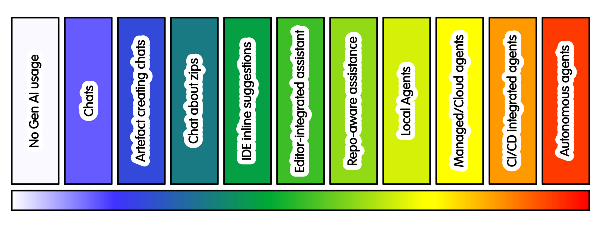

AI is becoming an increasingly visible part of research software development, but as the technology continues to develop, so does the need to understand how best it can be used. This was the focus of Michael Sparks’ recent RSECon26 talk, which covered the role of AI assistance in research software and what it means for software quality.

At [RSECon26](https://rsecon26.society-rse.org/), [Michael Sparks](https://www.linkedin.com/in/michael-sparks-uk/) explored what this rapid evolution means for research software engineers (RSEs) and the research community more broadly, asking an important question: how can we efficiently use AI while also maintaining the quality of the research software?

Drawing on the experience from EVERSE and the [Research Software Quality Toolkit (RSQKit)](https://everse.software/RSQKit/), Michael presented a spectrum of AI intensity based on the level of AI autonomy. On one end of the spectrum are simple interactions with AI through prompts and existing development tools, and further along are coding assistants and agentic approaches.

During his talk, he looked at where these approaches help in practice, including drafting, documentation, testing, support and routine development work. As AI takes on more of the development process, questions about software quality, reproducibility and transparency become increasingly important to consider, as outlined in Michael’s presentation. 

The discussion also centered around the role of human judgement. AI generated code still needs to have appropriate review and testing, with teams also having to consider how AI is documented and how contributions are credited. With tools that are more autonomous, the more important it is to be clear about responsibility and human oversight. 

Michael concluded by sharing practical suggestions for RSEs, projects, research infrastructures and institutions to adopt AI tools while also maintaining the key practices that make research software reliable, understandable and reusable. 

**New AI guidance in RSQKit**

Some of the questions Michael discussed during his talk are now reflected in a new section on AI in the RSQKit.
The new section provides practical guidance for using AI to create high quality research software. Rather than showing a single way to use AI, it instead looks at the spectrum of AI assistance and the different implications of increasing automation, considering AI through the lens of research software quality. Rather than showing a single way to use AI, it looks at the spectrum of AI assistance and the different implications of increasing automation, highlighting some key aspects for consideration: 

* Research correctness of output
* Guardrails
* Ability to rollback
* Reproducibility

 

  <a href="https://everse.software/RSQKit/ai
"
     style="background-color: purple; color: white; padding: 12px 16px; text-decoration: none; border-radius: 6px; display:flex; width: max-content; justify-content: center; align-items: center; font-size: 16px; line-height: 24px; margin:0;">Explore the new AI section of the RSQKit for yourself</a>

 

  <a href="https://zenodo.org/records/22668838
"
     style="background-color: purple; color: white; padding: 12px 16px; text-decoration: none; border-radius: 6px; display:flex; width: max-content; justify-content: center; align-items: center; font-size: 16px; line-height: 24px; margin:0;">Michael’s full presentation from RSECon</a>

