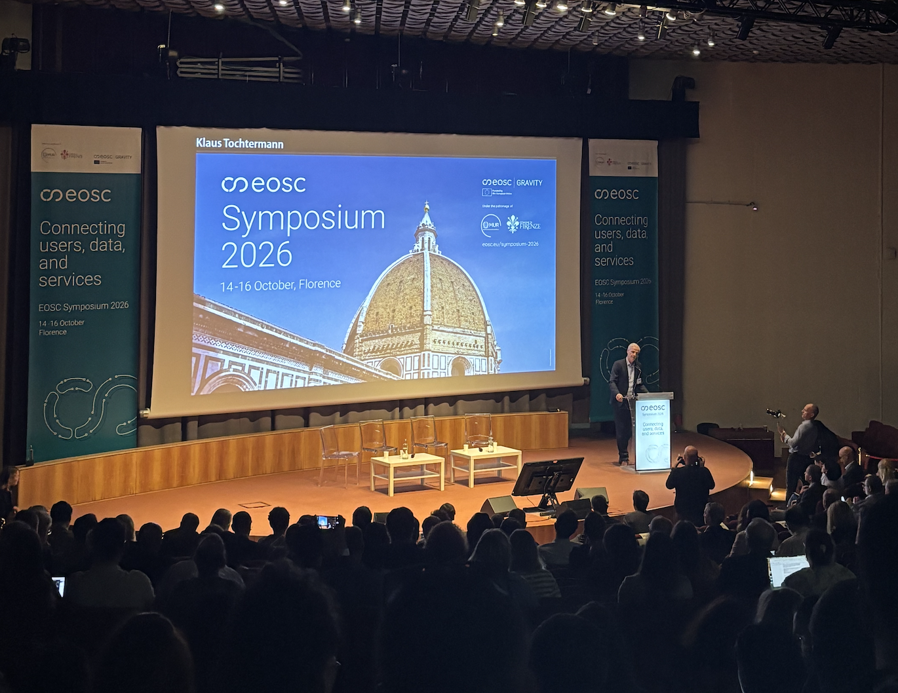
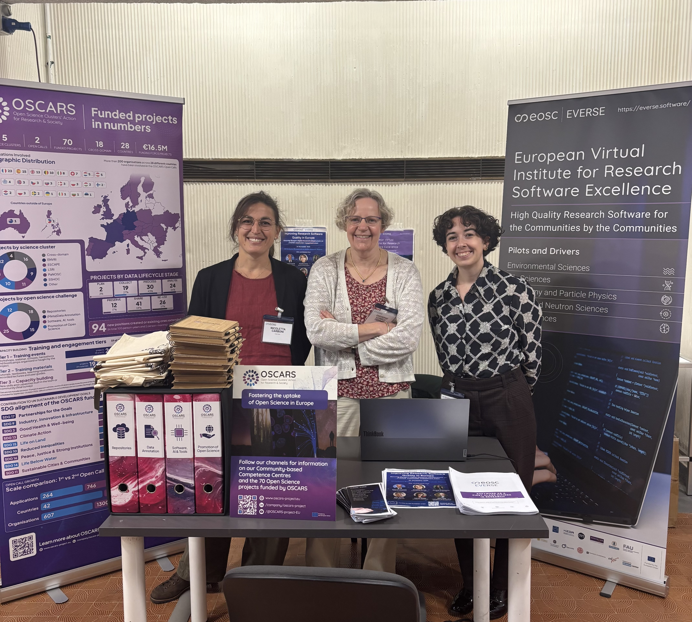
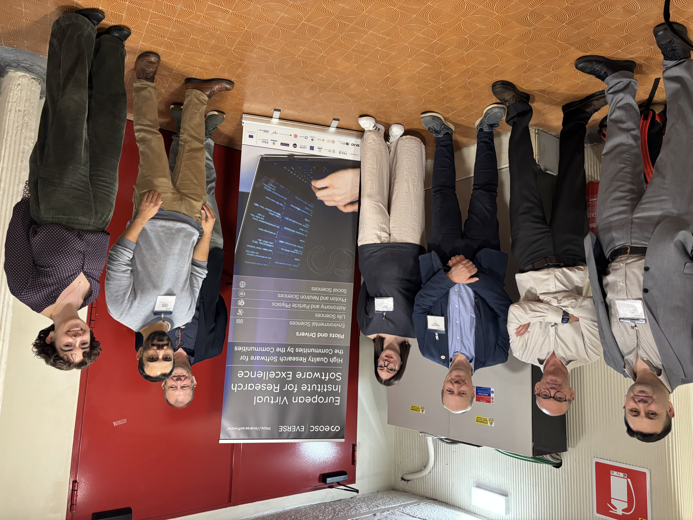

EVERSE recently participated in the  [EOSC Symposium](https://eosc.eu/symposium-2026) in Florence from 14-16 October 2026, which brought together over 500 participants from 35 countries — including policymakers, funders, researchers — to discuss the future of the [EOSC Association](https://eosc.eu/) and Federation and highlight the importance of high quality research software in open science.

We joined the [OSCARS](https://oscars-project.eu/) project on an exhibition booth, where we had the opportunity to chat with participants from across the research community and discuss EVERSE’s work in improving research software quality and how it can support researchers and the wider EOSC community. 

EVERSE also contributed and participated in several sessions across the three days. 

[Andy Götz](https://www.linkedin.com/in/andrew-gotz-990b309/) (EVERSE Scientific Advisory Board member) chaired and introduced the panel on the EOSC Federation User Forum, where he highlighted the importance of providing researchers with a shared space to share their experiences as well as ask each other questions and give feedback on services. 

[Peter Maccallum](https://www.linkedin.com/in/peter-maccallum-2867395/) (ELIXIR) contributed to discussions on the EOSC Federation’s infrastructure, drawing on experiences with the  Life Sciences Connect EOSC node. 

[Jonathan Tedds](/about/everse_people/jonathantedds/) (EVERSE Work Package 1 co-lead, ELIXIR) moderated a panel and Q&A session on the use of EOSC nodes and their benefits. The discussion explored how researchers and service providers can use connected resources to address specific challenges. These conversations highlighted the importance of understanding users’ needs and for continued collaboration as the EOSC Federation develops. They also reinforced the role of high quality research software in enabling researchers to make use of shared services, which is a key focus of our work within EVERSE. 

The symposium provided a valuable opportunity for EVERSE to contribute to these conversations across the European research system as the wider community continues to work towards making research software quality more reliable and reusable. 

We’ll be continuing some of these conversations at our upcoming stakeholder engagement event, Improving Research Software Quality in Europe, on 24th November, where we’ll be bringing together stakeholders, including policymakers, funders, RSEs and community managers in Brussels to explore the future of EVERSE and ongoing collaborative efforts to continue improving research software quality. 

  <a href="https://indico.cern.ch/event/1682301/
"
     style="background-color: purple; color: white; padding: 12px 16px; text-decoration: none; border-radius: 6px; display:flex; width: max-content; justify-content: center; align-items: center; font-size: 16px; line-height: 24px; margin:0;">Find out more about our stakeholder engagement event and how to register</a>

