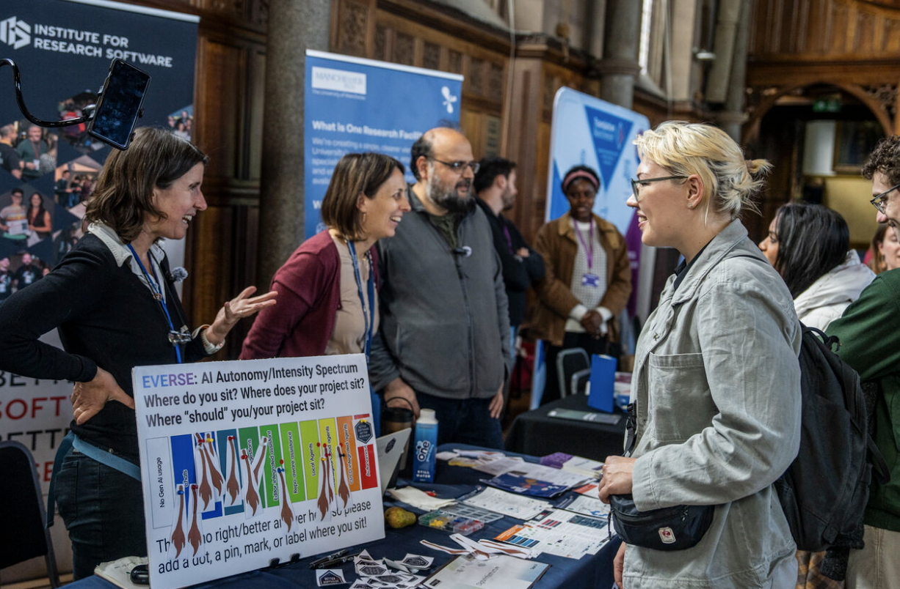
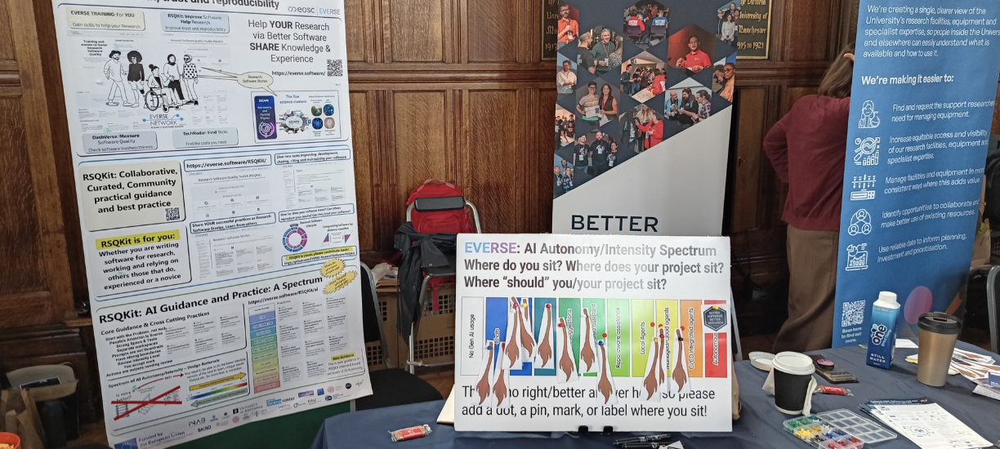
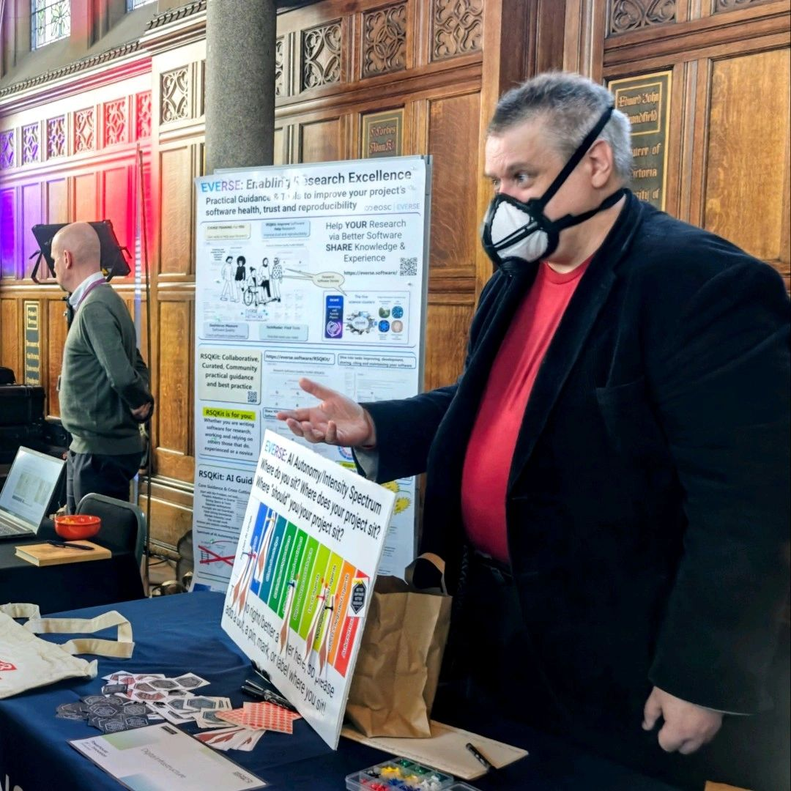

Photo by Caroline Jay

EVERSE recently took part in the University of Manchester [Innovation Festival](https://www.manchester.ac.uk/collaborate/innovation-festival/), introducing attendees from across the university (including professional services staff, researchers, academics and students) and the wider public to our work in supporting research software quality and responsible AI use in software development. 

Representing EVERSE, [Michael Sparks](https://www.linkedin.com/in/michael-sparks-uk/) introduced participants to the [Research Software Quality Kit (RSQKit)](https://everse.software/RSQKit/) and its new section on AI guidance. Joined also by [Caterina Doglioni](/about/everse_people/caterinadoglioni/) and [Aleksandra Nenadic](/about/everse_people/aleksandranenadic/), he highlighted the resources and services EVERSE provides for researchers, including guidance on research software quality, the science clusters and how people can join the community and collaborate with the project.

A key part of EVERSE’s stand during the “Powerhouse of Innovation Showcase” session on the third day of the festival was an interactive activity inviting people to put a marker on a spectrum ranging from ‘no AI use’ to ‘autonomous agents’. By playing a game of pin the (software) tail on a  donkey, they had the opportunity to reflect on how AI is currently used in their work and think about where they would like to be in the future. This activity encouraged discussions around different approaches to AI in software development while also collecting feedback on the spectrum. 

Participants were also directed towards taking a look at the new [AI guidance section of the RSQKit](https://everse.software/RSQKit/ai), where they can further explore the rationale behind the AI spectrum and also find practical guidance on AI use in research software. 

Find out more about the RSQKit: https://everse.software/RSQKit/
And its new AI section: https://everse.software/RSQKit/ai

  <a href="https://everse.software/RSQKit/
"
     style="background-color: purple; color: white; padding: 12px 16px; text-decoration: none; border-radius: 6px; display:flex; width: max-content; justify-content: center; align-items: center; font-size: 16px; line-height: 24px; margin:0;">Find out more about the RSQKit</a>

 

  <a href="https://everse.software/RSQKit/ai
"
     style="background-color: purple; color: white; padding: 12px 16px; text-decoration: none; border-radius: 6px; display:flex; width: max-content; justify-content: center; align-items: center; font-size: 16px; line-height: 24px; margin:0;">Explore the new AI section</a>

