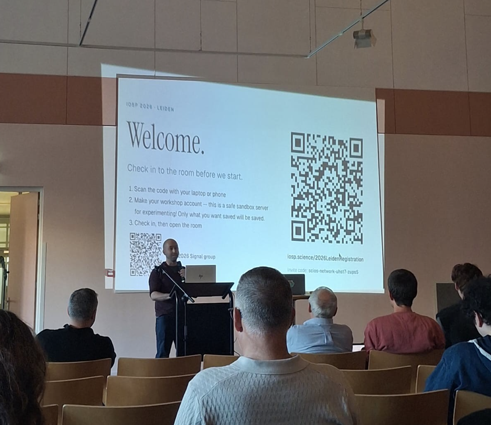

Research software plays an important role in scientific discovery, but it can be challenging to keep its metadata accurate and up to date. Recently at the [Institute of Open Science Practices (IOSP 2026)](https://www.iosp.science/), [Srobona Ghosh](https://www.linkedin.com/in/mohor21/) from Helmholtz-Zentrum Dresden-Rossendorf (HZDR) represented EVERSE, giving a presentation introducing a tool designed to help address this challenge.

IOSP 2026 took place from 12-15 October at the University of Leiden, bringing together researchers, infrastructure providers and open science leaders to develop and connect tools and infrastructure for open science. 
Srobona’s presentation focused on how to keep research software metadata in sync, where she showed a software metadata synchronisation tool based on CodeMeta, a standard that supports the description of research software through structured metadata.

By helping to keep software metadata synchronised, the tool aims to make software information easier to maintain and more consistent. This supports the wider goals of open science, helping research software remain discoverable, understandable and reusable.

 

  <a href="https://zenodo.org/records/23320597
"
     style="background-color: purple; color: white; padding: 12px 16px; text-decoration: none; border-radius: 6px; display:flex; width: max-content; justify-content: center; align-items: center; font-size: 16px; line-height: 24px; margin:0;">Explore Srobona's presentation</a>

 

  <a href="https://codebase.helmholtz.cloud/software-metadata-tool-pipeline/software-metadata-sync-tool
"
     style="background-color: purple; color: white; padding: 12px 16px; text-decoration: none; border-radius: 6px; display:flex; width: max-content; justify-content: center; align-items: center; font-size: 16px; line-height: 24px; margin:0;">Find out more about the tool</a>

