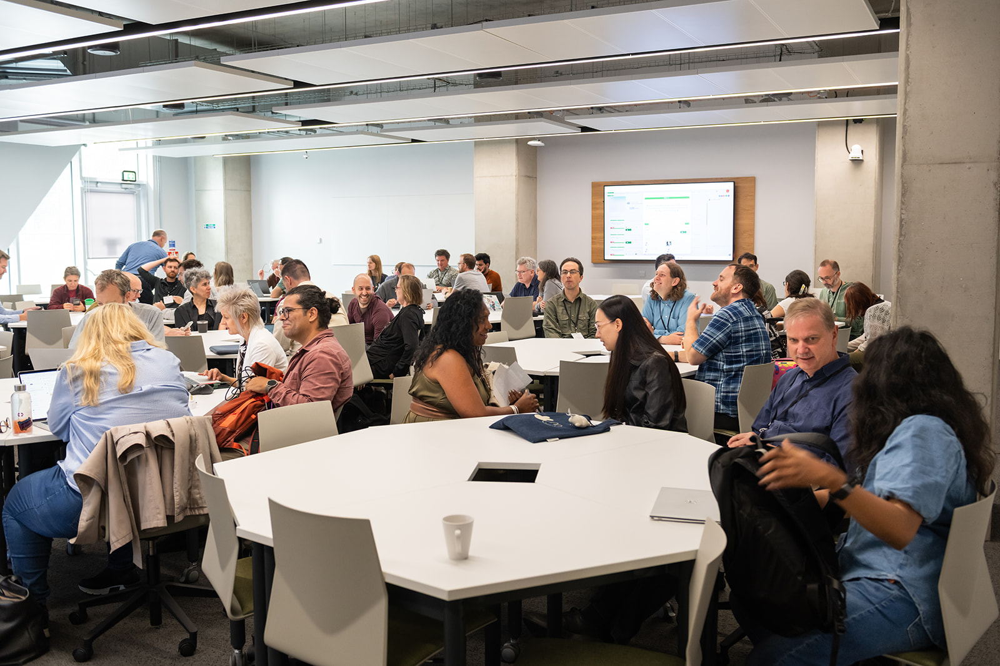

The [International Research Software Conference (IRSC26)](https://www.researchsoft.org/irsc/), organised by the [Research Software Alliance (ReSA)](https://www.researchsoft.org/), took place on 7–8 September 2026 in Sheffield, UK, bringing together research software professionals, community leaders, infrastructure providers, policymakers and other stakeholders from across the international research software ecosystem.

Over recent years, the research software landscape has grown considerably, with national and regional Research Software Engineering (RSE) associations, international initiatives, training networks and research infrastructures working to improve the recognition, quality and sustainability of research software. While this growth reflects the increasing importance of research software, it also presents challenges: overlapping activities, fragmented communication, duplicated efforts and missed opportunities for collaboration.

Against this background, on 8 September 2026, we organised a Birds of a Feather (BoF) session titled **"Connecting the Dots: Strengthening the European & Global Research Software Ecosystem through RSE Communities."** The session brought together representatives from different RSE communities, training organisations, research infrastructures and international initiatives to explore how existing efforts could become better connected.

Rather than proposing another organisational structure, the session focused on a practical question: **Where are the missing connections, and what small, achievable actions could help strengthen collaboration across the ecosystem?**

Photo credit: ReSA

## Where are the missing connections?

The discussion highlighted several recurring challenges that affect collaboration across research software communities.

**Fragmentation and duplication of effort.** Participants observed that different national and local networks frequently develop similar activities, training materials and community initiatives without necessarily being aware of each other's work. This is particularly evident in emerging areas such as generative AI training, research software skills development and community support.

While some duplication can be beneficial in responding to local needs, better visibility of existing resources and initiatives could help communities reuse and adapt each other's work rather than repeatedly starting from scratch. Participants pointed to opportunities for improving the discoverability of training materials and workflows through existing platforms, such as TeSS, and for exchanging experiences across national training networks.

**Too many conversations, not enough follow-through.** Another recurring concern was the growing number of events, meetings and discussion forums addressing similar topics. Although these activities create valuable opportunities for networking, participants noted that the same conversations can take place repeatedly with different groups, leaving limited time and capacity to translate discussions into practical outcomes.
This raised questions about how communities could coordinate events more effectively, maintain continuity between discussions and make better use of existing networks and communication channels.

**Finding the right people and communities.** Despite the existence of numerous networks, identifying the appropriate contact points or connecting with relevant initiatives can still be difficult. Personal relationships and recommendations remain essential for navigating the ecosystem, but relying primarily on individual connections creates challenges when people change roles or leave organisations.

Participants highlighted the value of making networks, activities and contact points more visible and accessible, while preserving the personal relationships that make communities effective.

## Communities are built around people, not just structures

One of the strongest messages emerging from the discussion was that successful collaboration depends on meaningful community engagement rather than simply establishing additional coordination mechanisms.
Participants emphasised the importance of meeting communities where they already operate, identifying local champions and building relationships through shared interests and activities. As one observation captured in the collaborative notes put it, **"Momentum does not happen top-down, it happens bottom-up."**

Examples from initiatives such as the Netherlands' research software training networks, The Carpentries and community-driven programming cafés illustrated how personal connections, mentoring and locally embedded activities can help sustain engagement.

The discussion also touched on the relationship between established initiatives that sometimes collaborate and sometimes compete, including for funding. Participants recognised that collaboration does not necessarily mean merging activities or eliminating all overlap. Instead, it can involve sharing practices, aligning metadata and resources, or directing participants towards existing initiatives when appropriate.

Importantly, community building requires sustained effort. Participants highlighted the critical role of community managers, mentors and other individuals who connect people and initiatives. However, this work is often under-resourced and dependent on the enthusiasm of a relatively small number of individuals, creating risks of burnout and loss of continuity.

**Strengthening the ecosystem therefore requires not only better connections, but also greater recognition, institutional support and dedicated resources for the people who maintain them.**

## From shared challenges to practical opportunities

The second part of the discussion explored what could be done to improve collaboration without creating unnecessary additional structures or administrative overhead.

**Several ideas emerged:**

* **Improve communication and discoverability.** Develop more effective ways to share information about communities, events, training materials and ongoing initiatives, building on existing channels and platforms wherever possible.

* **Strengthen community-to-community connections.** Encourage regular exchanges between national and regional RSE networks, training communities and community managers, including opportunities to connect fellows and local champions across countries.
  
* **Support shared training and resources.** Explore greater coordination around research software training, including emerging topics such as generative AI, and improve the reuse and discoverability of existing materials.
  
* **Invest in community engagement and sustainability.** Advocate for more dedicated community management capacity, institutional recognition and small-scale funding opportunities that enable bottom-up initiatives to develop.
  
* **Connect existing initiatives rather than duplicate them.** Build on networks and activities already in place, including communities of community managers and international RSE associations, to facilitate cooperation and exchange of experiences.

The discussion also highlighted opportunities to strengthen links between European initiatives and wider international communities, drawing inspiration from regional networks such as RSAfrica, RSLA and RSAA.

Initiatives such as EVERSE and its [Research Software Quality Toolkit (RSQKit)](https://everse.software/RSQKit/) were discussed in the context of engaging local RSE communities and building shared ownership of resources. This reinforced the importance of involving communities not only as users of project outputs, but also as active contributors to their development, adoption and long-term sustainability.

## What comes next?

The session reinforced that the research software ecosystem already has many of the networks, resources and expertise needed to address shared challenges. The opportunity lies in connecting these more effectively and ensuring that collaboration translates into sustained activities.

Rather than identifying a single solution, the discussion pointed towards several complementary approaches: improving the visibility of existing efforts, creating more opportunities for cross-community exchange, supporting local champions and community managers, and encouraging lightweight collaborative activities around shared challenges.

These ideas provide a useful starting point for continued engagement between interested communities and organisations. Further discussion will be needed to identify which activities can be taken forward through existing networks, where additional coordination would be beneficial, and who has the capacity to contribute.

A particularly important consideration is ensuring that any follow-up builds on existing community structures rather than introducing new coordination burdens.

Photo credit: ReSA

## Connecting the dots, together

The BoF highlighted both the diversity and the common challenges of the international research software ecosystem. Although communities operate in different institutional, national and disciplinary contexts, many face similar questions about sustainability, engagement, training, visibility and collaboration.

The central takeaway is that **building a more connected research software ecosystem is not necessarily about creating more initiatives, but about making better use of the connections, knowledge and communities we already have.**

This requires intentional engagement, recognition of the people who make collaboration possible, and practical opportunities for communities to learn from and support one another.

We thank everyone who contributed their experiences, ideas and perspectives during the session. We hope the discussion will encourage further connections and collaborative activities across the European and global RSE communities.

**Interested in continuing the conversation?** We encourage research software communities, community managers and other stakeholders to share their experiences and explore opportunities to work together on the challenges identified during the session.

## Resources

* [International Research Software Conference (IRSC)](https://www.researchsoft.org/irsc/)
* [Research Software Alliance (ReSA)](https://www.researchsoft.org/)
* [Research Software Quality Toolkit (RSQKit)](https://everse.software/RSQKit/)
* [Programming Café Playbook](https://code-cafes-nl.github.io/cafe_playbook/)

*Article by: [Selim Kalayci](https://www.linkedin.com/in/selimkalayci/), [Carlos Martinez](/about/everse_people/carlosmartinez-ortiz/), [Shoaib Sufi](/about/everse_people/shoaibsufi/), [Alexia Yiannouli](/about/everse_people/alexiayiannouli/), [John Apostolakis](/about/everse_people/johnapostolakis/) & [Jonathan Tedds](/about/everse_people/jonathantedds/)*

